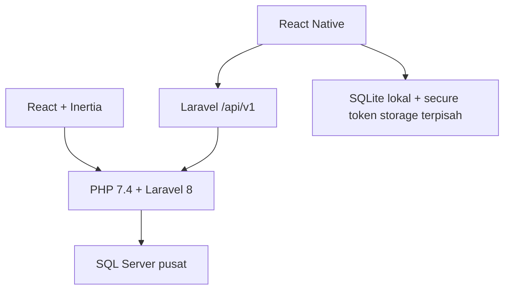
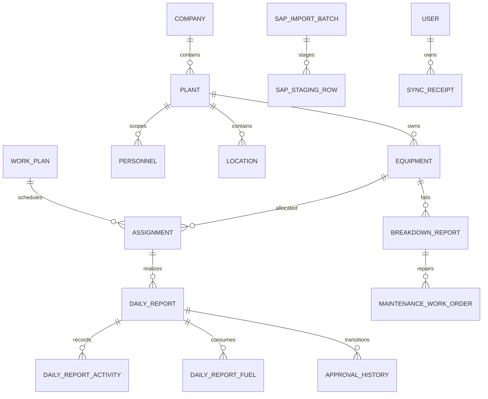

# EPITA — migrasi arsitektur

## Audit dan batas verifikasi
Laravel sudah berada di root repository dan dipertahankan agar server, path storage, dan data pengguna tidak rusak. `mobile/` akan berdiri terpisah. Backend tetap PHP 7.4/Laravel 8; Node hanya build/test frontend. Modul domain yang tersedia digunakan kembali melalui Service/Action. Web saat audit masih Blade/Bootstrap. SQL Server belum tersedia; jangan mengklaim migration atau query telah lulus SQL Server.



## Rencana file dan urutan pekerjaan
1. Foundation: config/database.php, .env.sqlsrv.example, middleware Inertia, resources/views/app.blade.php, resources/js/app.jsx, Layouts, Components, Pages. Pertahankan URL dan permission yang ada.
2. Konversi master, planning, laporan harian, approval, maintenance, SAP, dashboard dan laporan menjadi halaman React. Form memakai useForm dan validasi Laravel.
3. Tambahkan migration client_uuid/version, sync receipts, cursors, attachments checksum; endpoint SyncController dan SyncService menggunakan DailyReportService.
4. mobile/src/{api,database,sync,screens,navigation,components,hooks,store}; secure storage terpisah dari SQLite.
5. Test backend, React, offline queue, retry/conflict; SQL Server integration dan device QA memerlukan runtime terkait.

## ERD pusat (relasi inti)

Transaksi offline: server bigint id, unique client_uuid, integer server_version. Receipt unik per user + idempotency key dengan request hash; replay dengan payload berbeda ditolak. Status final tidak dapat ditimpa draft lama.

## Schema SQLite mobile yang direncanakan
local_profile, local_settings, master_equipment, master_personnels, master_locations, master_activities, master_units, assignments_cache, daily_report_drafts, daily_report_activities, daily_report_fuels, attachment_queue, sync_queue, sync_conflicts, sync_metadata.
Draft/queue memiliki client_uuid, local_updated_at, server_updated_at, sync_status, sync_attempts, last_sync_error. Token hanya keychain/keystore. Cache dibatasi pemilik akun; logout membersihkan cache sensitif.

## Urutan sinkronisasi
Login online → secure token → bootstrap scoped master/permissions → draft SQLite → enqueue dengan idempotency key tetap → push Laravel → lock + authorization + version check + domain validation + SQL transaction → receipt per item → pull delta cursor user/plant → acknowledge. Retry exponential backoff. Approval dan master server-wins; konflik memerlukan keputusan pengguna sesuai workflow. Attachment antrean terpisah dengan checksum.

## Status fase
Foundation sedang dikerjakan. Fase 2–8 belum dinyatakan selesai. UI lama tetap dapat digunakan selama konversi bertahap. SQL Server dan uji perangkat belum tersedia.

## Aktivasi foundation setelah jaringan tersedia
Kode React dan middleware disiapkan namun belum diregistrasi agar aplikasi existing tetap berjalan tanpa dependency baru.
```sh
PATH=/opt/homebrew/opt/php@7.4/bin:$PATH composer require inertiajs/inertia-laravel:^0.6
npm install react@18.3.1 react-dom@18.3.1 @inertiajs/react@1.3.0
```
Setelah instalasi, daftarkan HandleInertiaRequests pada grup web, tambahkan build esbuild bundle resources/js/app.jsx ke public/assets/inertia.js (NODE_ENV production), serta route authenticated Inertia::render Foundation dengan plants dari user. Verifikasi CSRF, session, scope dan frontend sebelum migrasi dashboard. Instalasi 15 Oktober tertahan DNS Packagist/npm; PHP lokal juga belum memiliki sqlsrv/pdo_sqlsrv.

## Status terbaru 15 Oktober 2026
Dependensi berhasil dipasang; React Inertia aktif untuk seluruh modul web. SQL Server terhubung dan migration diuji. Mobile React Native, SQLite, SecureStore, antrean, dan sync API sudah diimplementasikan; bundle Android/iOS berhasil diekspor. Rincian dan batas verifikasi terbaru pada REACT-MOBILE-DELIVERY.md dan SYNC-API.md. Catatan instalasi tertahan di atas merupakan histori sebelum jaringan berhasil tersedia.
