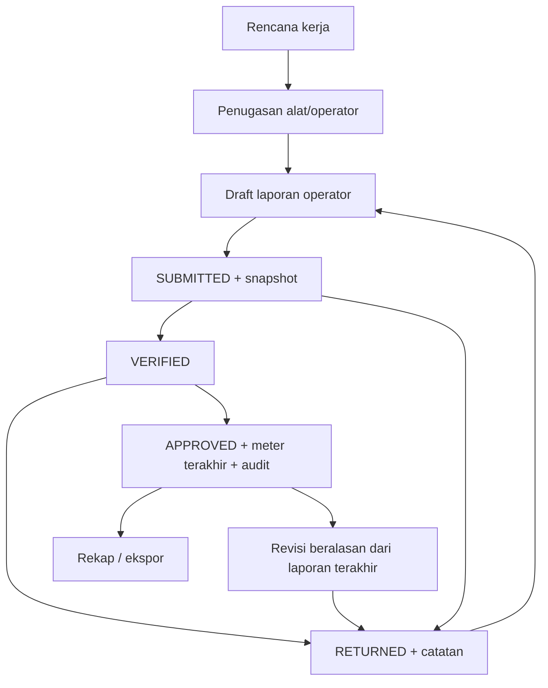
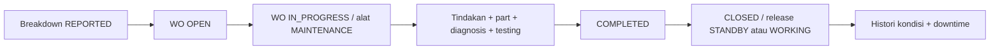
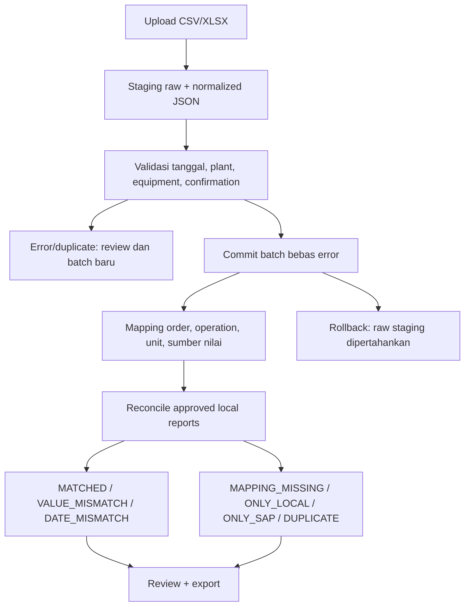

# Diagram workflow

Actual Work SAP tidak otomatis sama dengan jam kerja. Rule menentukan meter_total, work_hours atau volume dan unit yang disetujui. Approval mengunci equipment dan laporan dalam transaction. Revision snapshot tidak ditimpa. Maintenance tidak memakai tabel daily report.
