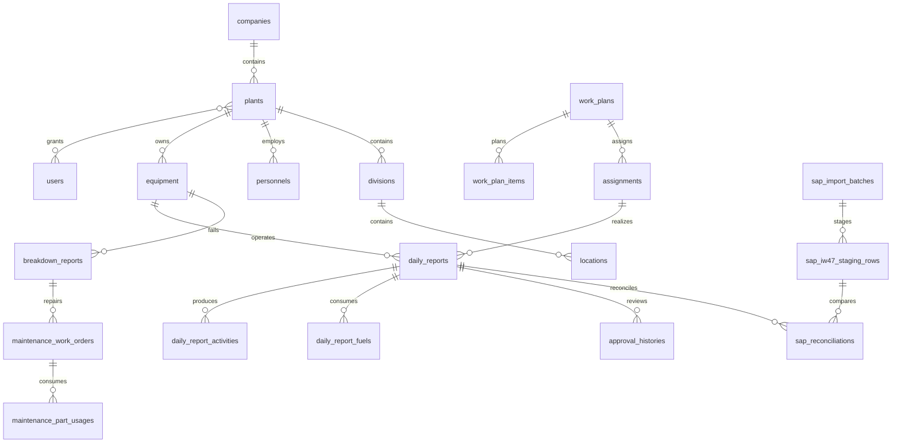

# Implementation plan

Laravel 8 MVC, explicit domain services and Spatie permissions. MySQL is the deployment database; SQLite is used for isolated automated tests and the local demonstration.

## File groups
- database/migrations: organization, scoped masters, operations, maintenance, SAP staging, audit and queue infrastructure.
- app/Models and Policies: relationships and per-record plant/ownership access.
- app/Services: report calculation/workflow, scheduling conflicts, maintenance transitions and SAP staging/reconciliation.
- app/Http: validated web/API endpoints and authentication.
- resources/views, public: Indonesian responsive Blade interface.
- tests: integration tests for authorization, workflows, calculations and import.

## Catatan fase dan hasil

| Fase | File utama dibuat/diubah | Keputusan / verifikasi |
|---|---|---|
| 1 Foundation | composer.json/lock, Auth controllers, Kernel/middleware, layouts/app, config/app/session, DatabaseSeeder | Laravel UI, Spatie, Sanctum, PHP 7.4.33, scope plant. Login lima role diuji. Boost dicoba tetapi tidak mendukung Laravel 8. |
| 2 Master | operational schema migration, Models, MasterRegistry, MasterController, master views, factories | FK/index/decimal, master soft delete, histori tetap dapat dibaca. CRUD permission/scoping diuji. |
| 3 Operasional | DailyReportRequest/Policy/Service/Calculator, AssignmentService, OperationsController, daily-report views | Transaksi + lock, kalkulasi server, foto privat, snapshot, revisi dari laporan terakhir, anti-approval sendiri. Workflow diuji. |
| 4 Maintenance | MaintenanceService, breakdown/WO/part models, assignment/maintenance attachments migrations, operations views | Status fisik terpisah, technician/actions/testing/release, planned/unplanned downtime. Lifecycle diuji. |
| 5 SAP | SapService/Controller, Iw47Import, mapping/staging/reconciliation models/views, samples | Raw JSON tidak ditimpa, commit/rollback batch, rule sumber nilai/unit. Import dan status exception diuji. |
| 6 Dashboard/laporan | DashboardService, ReportService/Controller, RowsExport, dashboard.js, reports views | DB aggregates, filter, unit-safe subtotal, Excel/CSV/PDF, antrean privat. Perhitungan/export diuji. |
| 7 Hardening | DomainModel, ActiveUser/SecurityHeaders/ApiEnvelope, AttachmentService, jobs, overdue command, tests, docs | Driver PHP 7.4 casts, versi keamanan sesi/token, formula safety, thumbnail, route/view cache. Review advisory dicatat. |

Commands yang dijalankan: composer require/update untuk dependency target PHP 7.4; artisan ui bootstrap --auth; vendor:publish permission; migrate --seed; db:seed --class=DemoScenarioSeeder; npm install/build; PHP 7.4 phpunit; artisan queue:work --stop-when-empty; view:cache; route:cache; composer validate/audit.

Lihat TEST-RESULTS.md untuk hasil terakhir. Instalasi bersih, seed, worker dan deployment dijelaskan di README.md/DEPLOYMENT.md. Seluruh code aplikasi berada di workspace; tidak ada posting SAP atau deployment eksternal.
