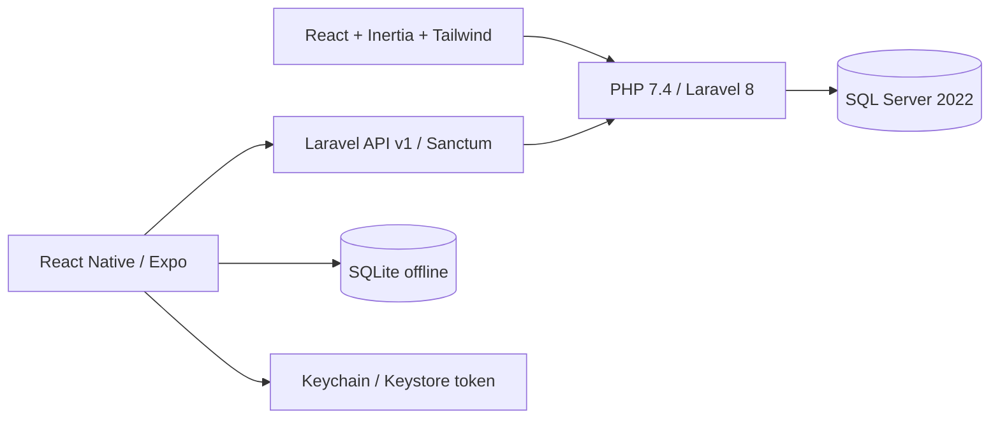

# EPITA — React web dan React Native

## Arsitektur aktif

Laravel tetap di root repository agar storage dan konfigurasi existing tidak berpindah. `mobile/` terpisah. React tidak mengakses SQL Server; tidak ada backend Node, SSR Node, service bisnis JavaScript, atau Firebase. Node hanya compile/test frontend dan Metro development tooling.

## Web
Seluruh halaman operasional menggunakan Inertia: login/reset password, dashboard, master CRUD, rencana, assignment, laporan/create/edit/detail, approval, breakdown, work order/detail, SAP import/preview/reconciliation, laporan/export, pengguna/roles, profil, plant, notifikasi, audit, dan pekerjaan latar belakang. Blade tersisa untuk root HTML, PDF server-side, template error, dan arsip tampilan lama; bukan jembatan HTML ke React.

React pages dikelompokkan di resources/js/Pages, reusable form/table/dialog/stat/icon di Components, layout di Layouts. Form menggunakan Inertia useForm dengan error Laravel. Page chunks dan Chart.js lazy-loaded. Styles memakai Tailwind + design tokens; Bootstrap tidak dimuat di root React. Assets memakai version hash agar client lama memuat ulang setelah deployment. Draft web disimpan per akun/per laporan di localStorage; server tetap sumber kebenaran.

## Menjalankan lokal
```sh
./scripts/docker compose -f compose.sqlsrv.yml up -d
./scripts/php74-sqlsrv artisan migrate --force
npm ci
npm run build
./scripts/serve
# Terminal lain:
./scripts/php74-sqlsrv artisan queue:work --timeout=300 --tries=1
./scripts/php74-sqlsrv artisan schedule:work
```
Buka http://127.0.0.1:8080. Akun demo tetap mengikuti README lokal. Driver sqlsrv dan pdo_sqlsrv lokal, ODBC, serta OpenSSL dimuat oleh wrapper, termasuk subprocess PHP. Jangan memakai PHP global 8.x untuk backend ini.

## Mobile
```sh
cd mobile
npm ci
cp .env.example .env
# Isi EXPO_PUBLIC_API_URL=https://alamat-laravel-anda/api/v1
npm start
npm run android
# Pada macOS dengan Xcode lengkap dan signing:
npm run ios
npm run export
npm test
```
Expo dipakai untuk React Native dan build tooling, bukan backend. Versi paket mengikuti bundledNativeModules Expo yang terkunci di package-lock. Android/iOS production harus mengarah ke HTTPS Laravel. Development tanpa env memakai alias host emulator Android 10.0.2.2:8080 atau simulator iOS 127.0.0.1:8080. Perangkat fisik memerlukan endpoint HTTPS yang dapat dijangkau; localhost di ponsel bukan Mac. Tidak ada endpoint production yang dipublikasikan oleh pekerjaan ini.

Layar: login, beranda/tugas, laporan offline, draft/riwayat, breakdown offline, sync center, perbandingan konflik, profil/logout. Foto disalin ke document storage privat sebelum masuk antrean. Form laporan autosave lokal dan mencatat helper, aktivitas, volume, BBM, kondisi, lokasi, waktu, serta meter. Token hanya SecureStore; logout menghapus cache dan file privat setelah konfirmasi pengguna. Login ulang akun sama mempertahankan draft saat token kedaluwarsa. Akun berbeda tidak dapat membaca cache akun sebelumnya.

SQLite memiliki tabel profile/settings, master equipment/personnel/location/activity/unit, assignment cache, draft, aktivitas, BBM, antrean foto, antrean sync, konflik, dan metadata. Schema lokal dikelola oleh mobile, bukan migration Laravel. Draft dan rincian aktivitas/BBM disimpan dalam transaksi lokal. Cache master diganti dari server saat bootstrap.

## Sinkronisasi
1. Bootstrap permission, profile dan master scoped Laravel; simpan token di secure storage.
2. Draft offline memiliki client_uuid; enqueue memiliki batch UUID tetap serta UUID submit terpisah.
3. Save batch memakai DailyReportService; Laravel menghitung ulang meter/waktu/BBM dan memvalidasi relasi/status/plant.
4. Unggah antrean foto ke draft server dengan Idempotency-Key; fingerprint server mencakup SHA-256 isi file.
5. Submit memakai batch UUID lain, setelah foto berhasil. Snapshot/approval tetap service PHP yang sama.
6. Pull delta memakai journal sync_changes dan encrypted cursor terikat user, security_version, plant scope, serta expiry 7 hari. Cursor salah/kedaluwarsa dibootstrap ulang sekali oleh mobile.
7. Cursor disimpan sesudah delta diterapkan lalu di-acknowledge. Retry exponential backoff maksimum 5 menit; permintaan yang belum diketahui hasilnya memakai key tetap.
8. Versi berbeda menghasilkan CONFLICT. Final status tidak dapat ditimpa. Operator dapat memilih server atau meninjau ulang draft lokal bila server masih DRAFT/RETURNED miliknya. Laravel tetap mengotorisasi ulang.

Request receipt disimpan dalam transaksi; payload berubah pada key yang sama ditolak 409. Replay tetap diperiksa terhadap plant/akses saat ini. sync_receipts tidak boleh dibersihkan sembarangan selama periode retry klien. Sebelum menerapkan retensi, tetapkan umur maksimum antrean offline dan arsip receipt sesuai kebijakan operasional.

## Verifikasi dan batas rilis
- Backend regression diuji pada SQL Server epita_test terpisah dan SQLite test memory, bukan data aplikasi.
- React Testing Library memeriksa input nested, label, empty state, status, dan escaping.
- Mobile orchestration test memeriksa save → foto → submit, koneksi putus/replay key, retry bounded, dan larangan overwrite status final.
- Bundle Hermes Android dan iOS berhasil diekspor. Ini bukan APK/IPA atau bukti pengujian perangkat.
- 50 kombinasi halaman/viewport 360, 768, 1024, 1366, 1920 diuji tanpa overflow horizontal.
- Komputer belum memiliki JDK/Android SDK/Xcode lengkap/perangkat. Uji mode pesawat, kamera, SecureStore native, SQLite native, dan upload terputus pada perangkat tetap perlu dijalankan sebelum rilis.
- Lighthouse belum diukur; tidak ada klaim skor 85/90.
- PHP 7.4/Laravel 8 dipertahankan sesuai batas existing. Composer audit masih melaporkan advisori pada dependensi legacy; audit npm juga melaporkan beberapa dependency tooling. Jangan menyebut build ini lolos seluruh security acceptance production. Hasil audit disimpan lokal pada .local; review upgrade kompatibel/mitigasi sebelum exposure production.
